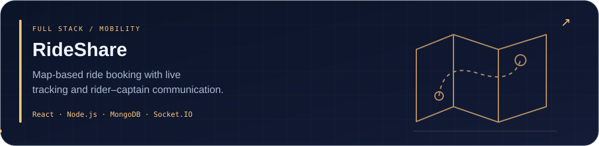
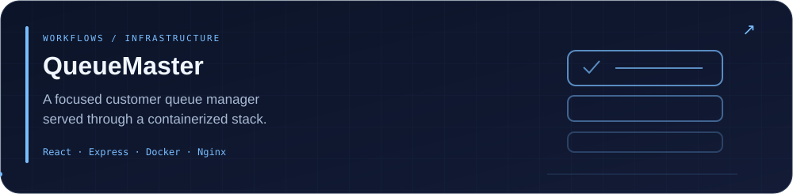

 

  

**Computer Science @ LNMIIT, Jaipur** · Full stack development · Competitive programming

I build across the web and AI, and contribute fixes to the software people use.

 

<!-- Selected projects are curated; descriptions reflect their public READMEs. -->

<a href="https://github.com/techvoyager-varun?tab=repositories">Explore all public repositories ↗</a>

 

 

Contributions to <a href="https://github.com/fossasia/eventyay">FOSSASIA Eventyay</a>, <a href="https://github.com/activist-org/activist">activist</a> and <a href="https://github.com/TEAMMATES/teammates">TEAMMATES</a>.

<!-- CONTRIBUTIONS:START -->

<!-- CONTRIBUTIONS:END -->

<a href="https://github.com/pulls?q=is%3Apr+author%3Atechvoyager-varun+is%3Amerged+-user%3Atechvoyager-varun">Browse my merged open source contributions ↗</a>

 

<!-- METRICS:START -->

<!-- METRICS:END -->

 

Original SVG artwork · Daily public GitHub updates · <a href="https://github.com/techvoyager-varun/techvoyager-varun/actions/workflows/refresh-profile.yml">Refresh status</a>

