<picture><source media="(max-width: 600px)" srcset="assets/hero-mobile.svg" />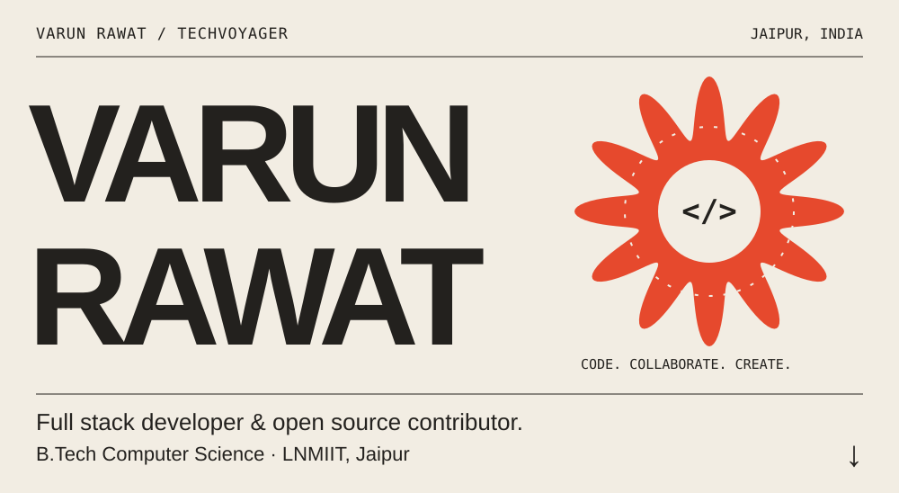</picture>

<a href="https://www.linkedin.com/in/varun-rawat072">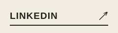</a>
<a href="https://codeforces.com/profile/techvoyager">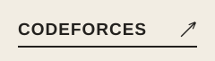</a>
<a href="mailto:varunrawat5758@gmail.com">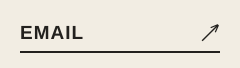</a>

<picture><source media="(max-width: 600px)" srcset="assets/projects-heading-mobile.svg" />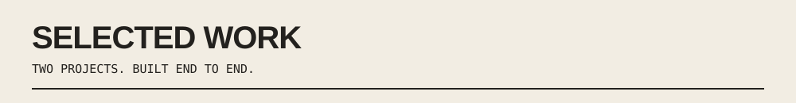</picture>

<a href="https://github.com/techvoyager-varun/Filmory"><picture><source media="(max-width: 600px)" srcset="assets/filmory-mobile.svg" />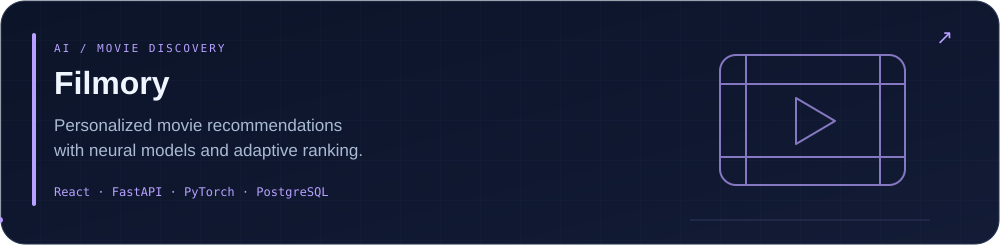</picture></a>

<a href="https://github.com/techvoyager-varun/CodeCollab"><picture><source media="(max-width: 600px)" srcset="assets/codecollab-mobile.svg" />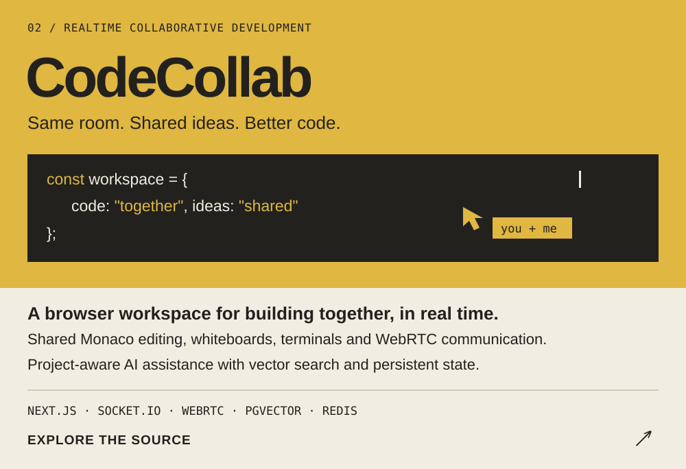</picture></a>

<a href="https://code-collab-ivory-five.vercel.app/">Try CodeCollab ↗</a> &nbsp; · &nbsp; <a href="https://github.com/techvoyager-varun?tab=repositories">All public repositories ↗</a>

<picture><source media="(max-width: 600px)" srcset="assets/stack-heading-mobile.svg" />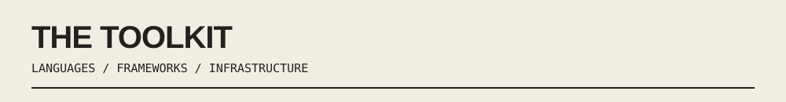</picture>
<picture><source media="(max-width: 600px)" srcset="assets/toolkit-mobile.svg" />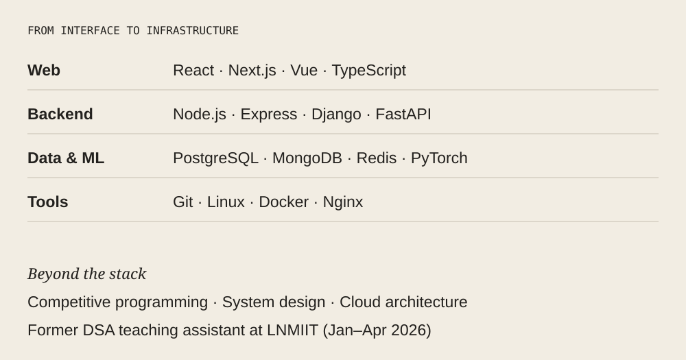</picture>

<picture><source media="(max-width: 600px)" srcset="assets/opensource-heading-mobile.svg" />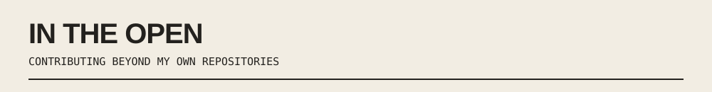</picture>

<a href="https://github.com/fossasia/eventyay">FOSSASIA / Eventyay</a> &nbsp; · &nbsp; <a href="https://github.com/activist-org/activist">activist</a> &nbsp; · &nbsp; <a href="https://github.com/TEAMMATES/teammates">TEAMMATES</a>

<!-- CONTRIBUTIONS:START -->
<a href="https://github.com/fossasia/eventyay/pull/6022"><picture><source media="(max-width: 600px)" srcset="assets/contribution-1-mobile.svg" />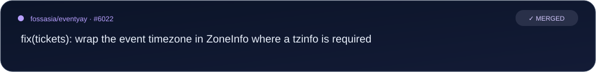</picture></a>
<a href="https://github.com/fossasia/eventyay/pull/6201"><picture><source media="(max-width: 600px)" srcset="assets/contribution-2-mobile.svg" />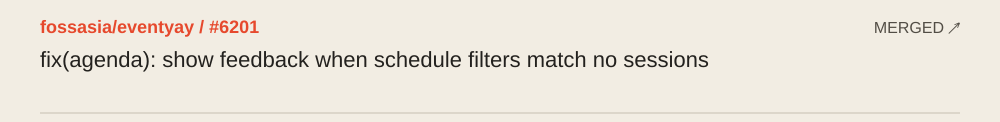</picture></a>
<a href="https://github.com/fossasia/eventyay/pull/6020"><picture><source media="(max-width: 600px)" srcset="assets/contribution-3-mobile.svg" />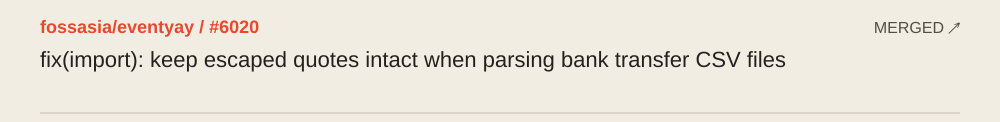</picture></a>
<a href="https://github.com/fossasia/eventyay/pull/5751"><picture><source media="(max-width: 600px)" srcset="assets/contribution-4-mobile.svg" />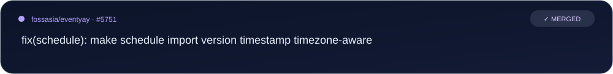</picture></a>
<a href="https://github.com/activist-org/activist/pull/2133"><picture><source media="(max-width: 600px)" srcset="assets/contribution-5-mobile.svg" />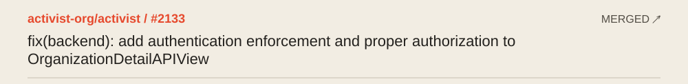</picture></a>
<a href="https://github.com/activist-org/activist/pull/2129"><picture><source media="(max-width: 600px)" srcset="assets/contribution-6-mobile.svg" />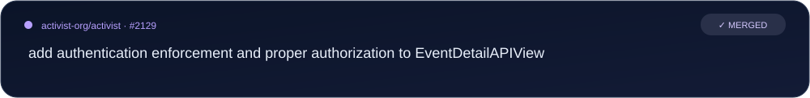</picture></a>
<!-- CONTRIBUTIONS:END -->

<a href="https://github.com/pulls?q=is%3Apr+author%3Atechvoyager-varun+is%3Amerged+-user%3Atechvoyager-varun">All merged open source contributions ↗</a>

<picture><source media="(max-width: 600px)" srcset="assets/activity-heading-mobile.svg" />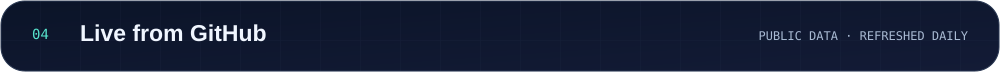</picture>
<!-- METRICS:START -->
<picture><source media="(max-width: 600px)" srcset="assets/metrics-mobile.svg" />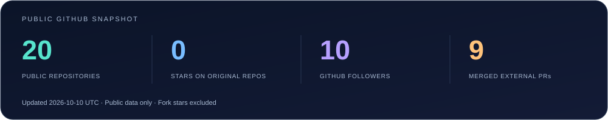</picture>
<!-- METRICS:END -->

<a href="https://x.com/VarunR25117">X / Twitter</a> &nbsp; · &nbsp; <a href="https://github.com/techvoyager-varun/techvoyager-varun/actions/workflows/refresh-profile.yml">Daily refresh status</a>

